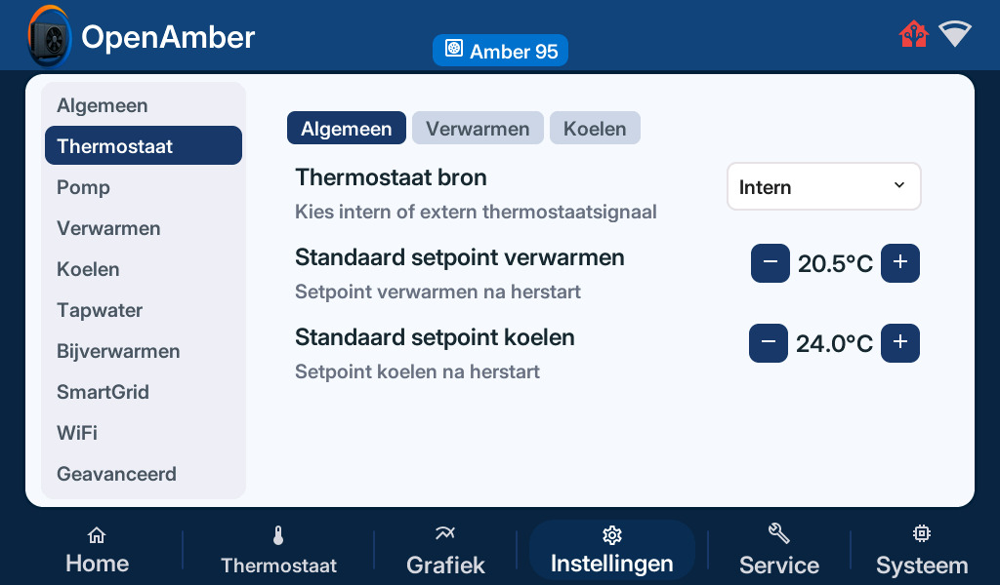
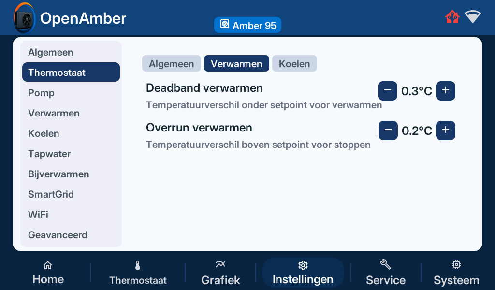
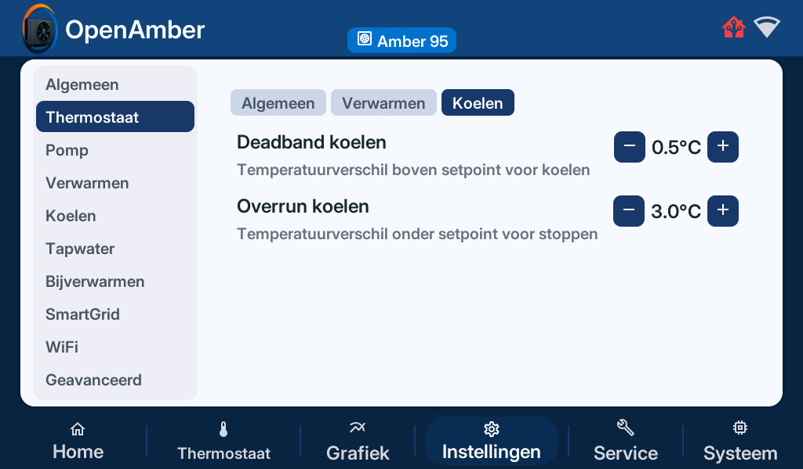

# Thermostaat

De thermostaatinstellingen configureren de temperatuurregeling van het binnenklimaat. OpenAmber kan als zelfstandige thermostaat functioneren (via de ingebouwde ruimtetemperatuursensor van het touchscreen display) of worden aangestuurd door een externe thermostaat of domoticasysteem.

::: tip Home Assistant synchronisatie
Alle onderstaande instellingen zijn via het touchscreen en via Home Assistant aanpasbaar. Wijzigingen worden direct doorgevoerd en opgeslagen.
:::

## Categorie: Algemeen

| Instelling | Opties / Bereik | Standaard | Home Assistant entiteit | Beschrijving |
| :-- | :-- | :-- | :-- | :-- |
| **Thermostaat bron** | Intern / Extern | Extern | `select.thermostat_mode_select` | Bepaalt welke thermostaat leidend is voor de warmte- en koelvraag. Kies `Intern` als het OpenAmber touchscreen display als kamerthermostaat in de woonkamer hangt. Kies `Extern` wanneer een bestaande kamerthermostaat (potentiaalvrij contact) of Home Assistant de warmtevraag stuurt. |
| **Standaard setpoint verwarmen** | 10.0 t/m 30.0 °C (stap 0.1) | 20.5 °C | `number.thermostat_default_heat_setpoint` | Gewenste kamertemperatuur voor verwarmen na een herstart van het systeem of bij terugkeer naar de standaardinstellingen. |
| **Standaard setpoint koelen** | 18.0 t/m 30.0 °C (stap 0.1) | 24.0 °C | `number.thermostat_default_cool_setpoint` | Gewenste kamertemperatuur voor koelen na een herstart van het systeem. |
| **Uitschakelvertraging (extern signaal)** | 0 t/m 60 min (stap 5) | 0 min | `number.thermostat_off_delay` | Vertraging waarmee de warmte-/koelvraag van een extern thermostaatsignaal wordt gerest nadat het signaal wegvalt. Voorkomt schakelingen bij een thermostaat die het contact kort laat vallen. |

---

## Categorie: Verwarmen

Deze parameters bepalen de hysterese en schakelgrenzen van de interne thermostaat bij verwarmen.

| Instelling | Opties / Bereik | Standaard | Home Assistant entiteit | Beschrijving |
| :-- | :-- | :-- | :-- | :-- |
| **Deadband verwarmen** | 0.1 t/m 5.0 °C (stap 0.1) | 0.3 °C | `number.thermostat_heat_deadband` | Aantal graden dat de kamertemperatuur onder het setpoint moet zakken voordat de verwarmingsvraag inschakelt (Inschakeltemperatuur = `Setpoint - Deadband`). |
| **Overrun verwarmen** | 0.1 t/m 5.0 °C (stap 0.1) | 0.2 °C | `number.thermostat_heat_overrun` | Aantal graden dat de kamertemperatuur boven het setpoint mag oplopen voordat de verwarmingsvraag stopt (Uitschakeltemperatuur = `Setpoint + Overrun`). Voorkomt dat de verwarming direct bij het bereiken van het setpoint stopt en daarna snel weer start. |

---

## Categorie: Koelen

Deze parameters bepalen de hysterese en schakelgrenzen van de interne thermostaat bij koelen.

| Instelling | Opties / Bereik | Standaard | Home Assistant entiteit | Beschrijving |
| :-- | :-- | :-- | :-- | :-- |
| **Deadband koelen** | 0.1 t/m 5.0 °C (stap 0.1) | 0.5 °C | `number.thermostat_cool_deadband` | Aantal graden dat de kamertemperatuur boven het koelsetpoint moet stijgen voordat de koelvraag inschakelt (Inschakeltemperatuur = `Setpoint + Deadband`). |
| **Overrun koelen** | 0.1 t/m 10.0 °C (stap 0.1) | 3.0 °C | `number.thermostat_cool_overrun` | Aantal graden dat de kamertemperatuur onder het koelsetpoint mag zakken voordat de koeling stopt (Uitschakeltemperatuur = `Setpoint - Overrun`). |

---

## Categorie: Ruimtetemperatuur bron (BLE sensoren)

Op display-builds kan OpenAmber Bluetooth LE temperatuur-/vochtigheidssensoren gebruiken (ATC, BTHome en SwitchBot uitzendingen). Koppel sensoren via **Connectiviteit > Bluetooth** (schakel Bluetooth in en maak de sensoren zichtbaar met zoeken); ze verschijnen daarna als bron bij de ruimtetemperatuur.

| Instelling | Opties / Bereik | Standaard | Home Assistant entiteit | Beschrijving |
| :-- | :-- | :-- | :-- | :-- |
| **Bluetooth** | Aan / Uit | Uit | `switch.ble_enabled_switch` | Zet de Bluetooth-ontvanger aan op Connectiviteit > Bluetooth. Sensorkoppeling en gevonden sensoren beheer je op dezelfde pagina. |
| **Ruimtetemperatuur bron** | Tr / BLE 1 / BLE 2 / BLE 3 | Tr | `select.room_temperature_source_select` | Kieta welke sensor de ruimtetemperatuur voor de interne thermostaat levert: de bedrade Tr-sensor van het display of een van de drie gekoppelde BLE-sensoren. |
| **BLE sensor MAC** | MAC-adres | leeg | `text.ble_device_mac` / `text.ble_device_mac_2` / `text.ble_device_mac_3` | Het MAC-adres van de sensor in koppel-slot 1 t/m 3. Sensoren die langer dan de timeout niets hebben uitgezonden worden als onbetrouwbaar gemarkeerd. |

---

## Categorie: Draadloze thermostaat (ESP-NOW)

Naast de bedrade aansluiting kan OpenAmber via ESP-NOW draadloos met een OpenAmber-thermostaat communiceren: temperaturen, setpoints en modus worden gedeeld en setpoint-/moduscommando's van de thermostaat worden uitgevoerd. Verkeer is versleuteld en voorzien van rollende codes tegen herhaling (replay).

::: warning Standaard gedeactiveerd in Home Assistant
De onderstaande entiteiten zijn standaard gedeactiveerd in Home Assistant (`disabled_by_default`). Zet ze aan via **Instellingen → Entiteiten** (toon uitgeschakelde entiteiten), of gebruik de schakelaar op het display bij **Thermostaat > Algemeen** (pagina 2).
:::

| Instelling | Opties / Bereik | Standaard | Home Assistant entiteit | Beschrijving |
| :-- | :-- | :-- | :-- | :-- |
| **Draadloze thermostaat** | Aan / Uit | Uit | `switch.thermostat_link_enabled` | Zet de ESP-NOW thermostaatlink aan (Algemeen, pagina 2). Bij de eerste inschakeling genereert OpenAmber een 6-cijferige koppelcode die op de thermostaat moet worden ingevoerd. Werkte alleen wanneer **Thermostaat bron** op `Intern` staat. |
| **Koppelcode** | - | - | `text_sensor.thermostat_link_code_text` | De gegenereerde koppelcode, zichtbaar onder de schakelaar op het display en als text sensor. |
| **Nieuwe koppelcode** | Knop | - | `button.thermostat_link_new_code` | Genereert een nieuwe koppelcode; de thermostaat moet daarna opnieuw gekoppeld worden. |
