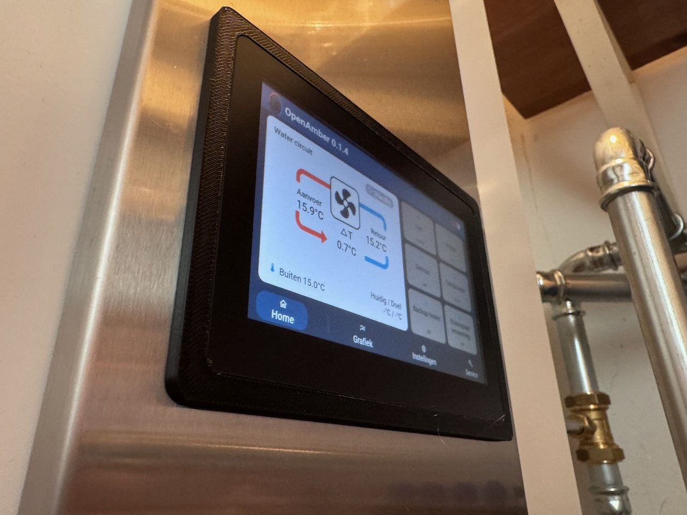
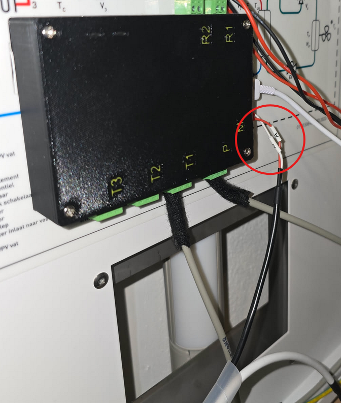

# Hardware

Dit is het overzicht van ondersteunde hardware voor OpenAmber.

## Hardwarekeuzes

**Aanbevolen: Waveshare ESP32-S3 Touch LCD 5 inch**.

| Board | Wanneer gebruiken | Firmwarevariant | Detailpagina | Impressie |
| --- | --- | --- | --- | --- |
| Waveshare ESP32-S3 Touch LCD 5 inch (aanbevolen) | Als complete vervanging van het originele WinCE-scherm en aansturing, met geintegreerd touchscreen. | `openamber-esp32s3` | [Waveshare 5 inch](./waveshare-5-inch.html) |  |
| Waveshare ESP32-P4 WIFI6 Touch LCD 7 inch | Groter 7 inch touchscreen (1024x600, MIPI-DSI) met bedrade ethernet (W5500); wifi en Bluetooth lopen via een ESP32-C6 coprocessor (ESP-Hosted), inclusief BLE-sensorondersteuning. | `openamber-esp32p4` | - | - |
| Amber Control Module (Electropaultje / leejoow) | Als je deze module al gebruikt en OpenAmber-aansturing zonder eigen scherm wilt. | `openamber-esp32` | [Amber Control Module](./leejoow.html) |  |

## Volgende stap

Na je hardwarekeuze ga je verder naar [Installatie](./installatie.html).
